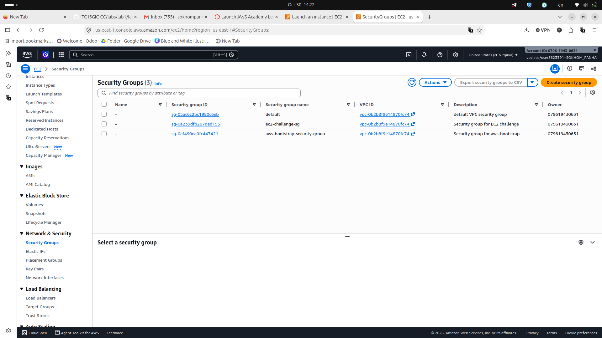
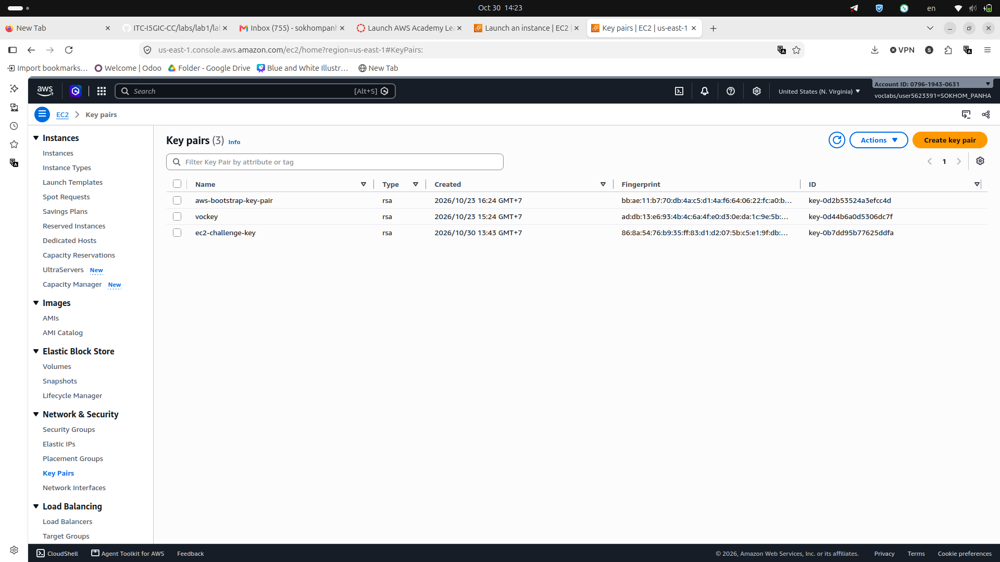
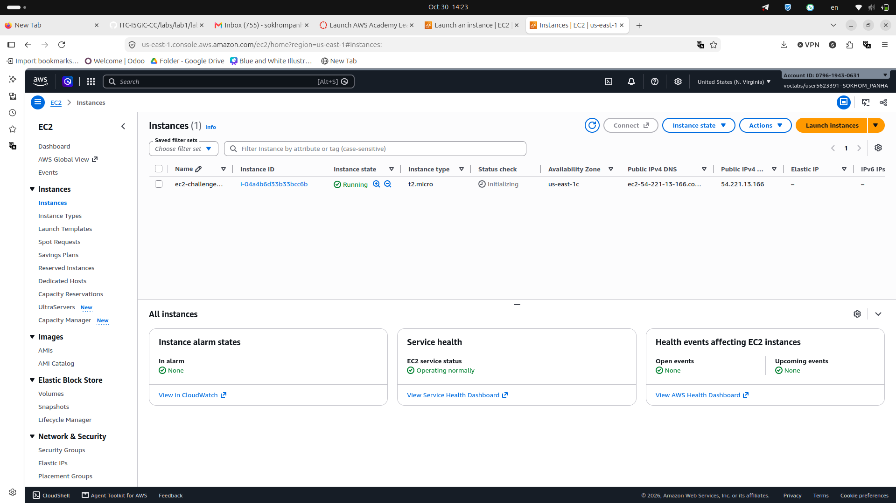
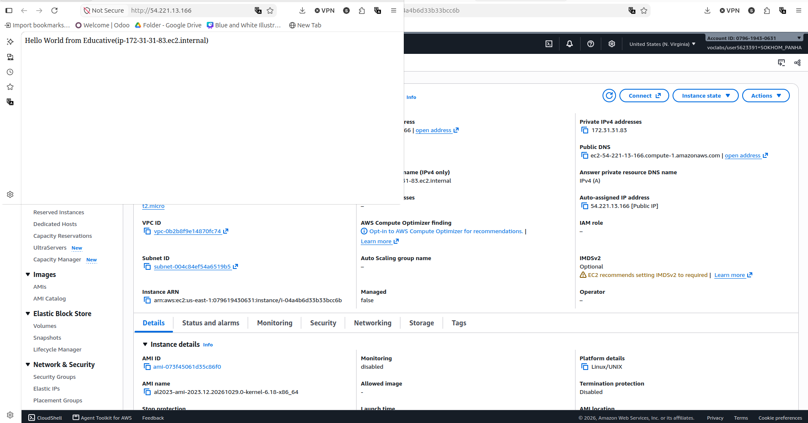
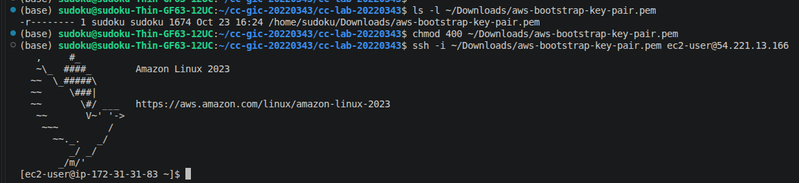
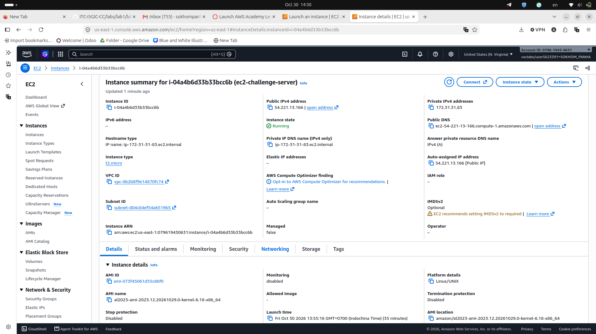
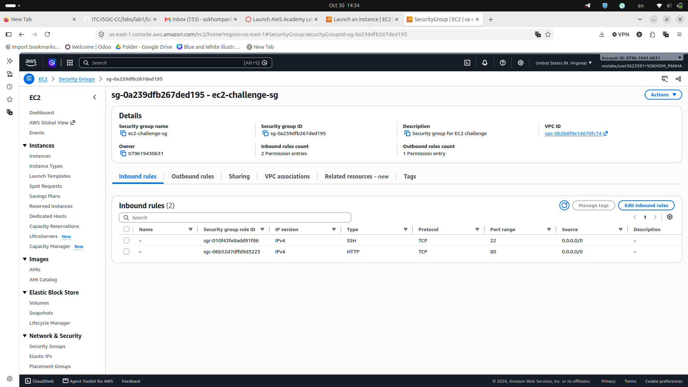
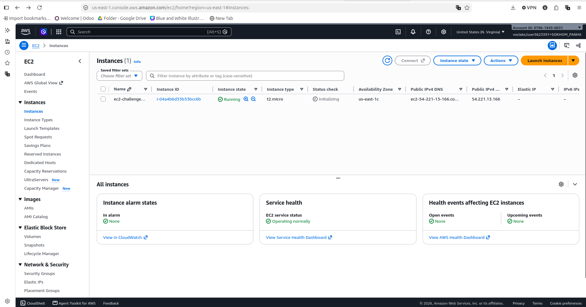
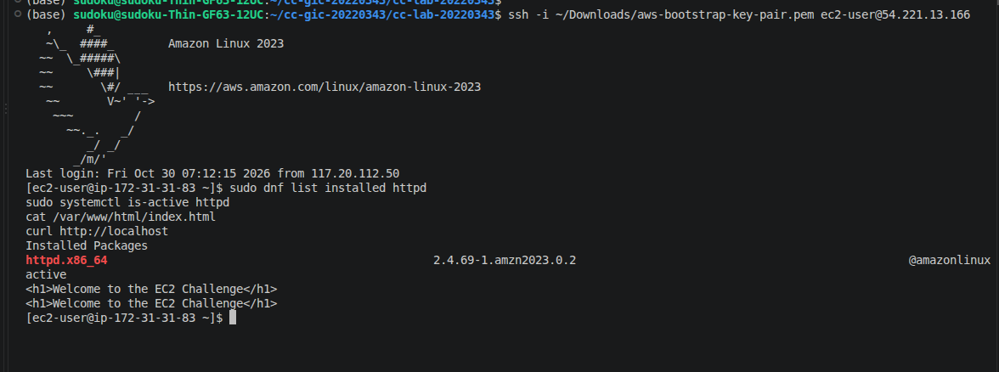
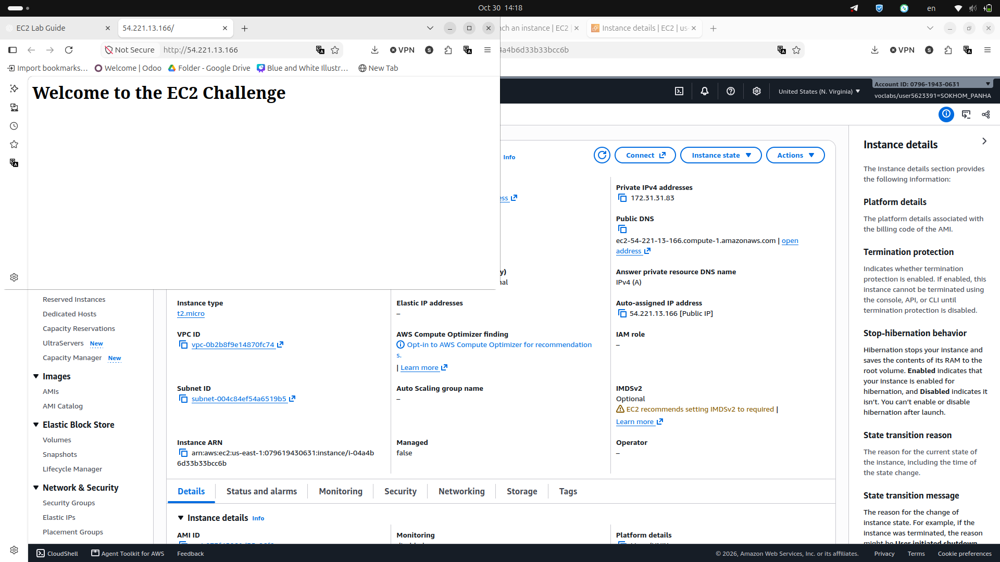

# Cloud Lab 1 Submission — Amazon EC2

Copy this template to `cc-lab-YOUR_ID/lab1/README.md` in your own repository. Follow [the instructions](lab1-instruction.md). Put your screenshots in `lab1/images/` with the file names below.

- **Student name: SOKHOM Panha**
- **Student ID: e20220343**
- **Learner Lab user name: voclabs/user5623391=SOKHOM_PANHA**
- **Date completed:30, Oct, 2026**

---

## Part 1.1 — An Amazon EC2 Walkthrough

### Security group



### Key pair



### Instance details



### Browser test



### SSH connection



Did you connect with your own SSH client or with EC2 Instance Connect?

---

## Part 1.2 — EC2 Web Solution (Challenge)

### Launch configuration



### Security group



### Running instance



### Commands on the instance



Paste the commands you ran to install the web server and create `index.html`:

```bash
sudo yum update -y
sudo yum install -y httpd
sudo systemctl start httpd
sudo systemctl enable httpd
sudo sh -c 'echo "Welcome to the EC2 Challenge" > /var/www/html/index.html'
```

### Browser test



---

## Questions

1. SSH lets you remotely connect to the server. HTTP lets browsers load the web page. If the HTTP rule is deleted, the web page will not open.
2. A **user data script** installed it during the first boot of the instance.
3. The server only uses HTTP and has no HTTPS/TLS certificate or port 443 configuration.
4. The 10 GiB root volume was set under **Advanced details → Storage → Configure storage → Root volume → Size (GiB)** in the launch settings. Check it with `lsblk` and `df -h /` on the instance.

## Problems and how I solved them (optional)

- No major problems.

## AI note (optional)

I asked AI for commands to install Apache. I checked and ran them with `sudo` on the EC2 instance, then confirmed the page in the browser.

## Clean up

- [ ] Part 1.1: instance terminated, key pair and security group deleted.
- [ ] Part 1.2: instance terminated, security group (and key pair, if any) deleted.
