# Cloud Lab 2 Submission — Load Balancer and Auto Scaling

Copy this template to `cc-lab-YOUR_ID/lab2/README.md` in your own repository. Follow [the instructions](lab2-instruction.md). Put your screenshots in `lab2/images/` with the file names below.

- **Student name:** SOKHOM PANHA
- **Student ID:** e20220343
- **Learner Lab user name:** voclabs/user5623391=SOKHOM_PANHA
- **Date completed:** November 6, 2026

---

## Security groups

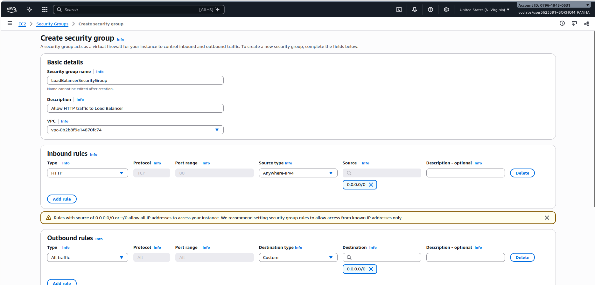

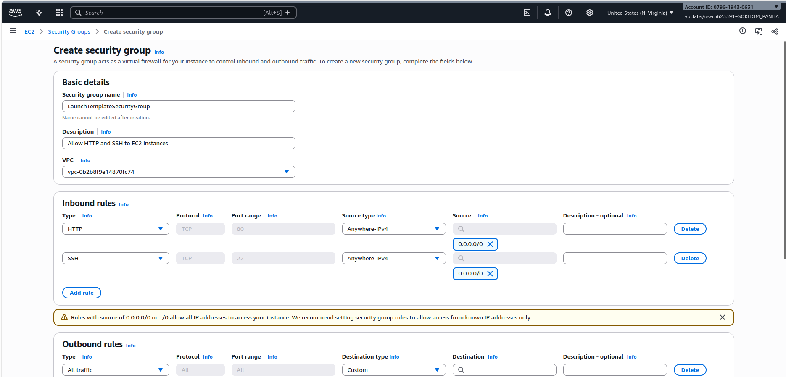

## Target group

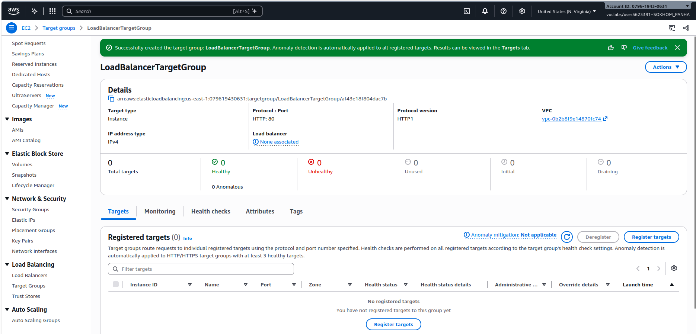

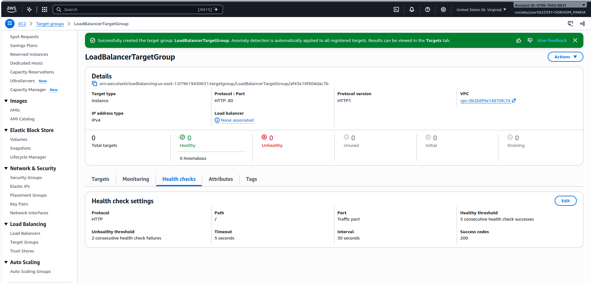

## Application Load Balancer

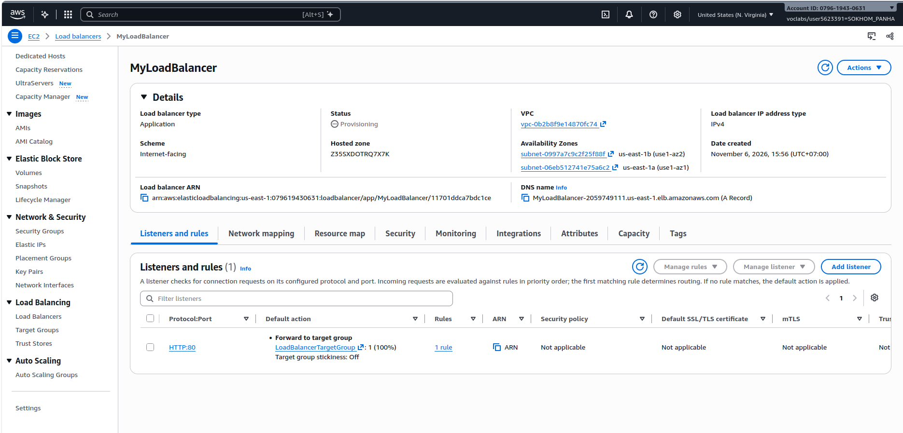

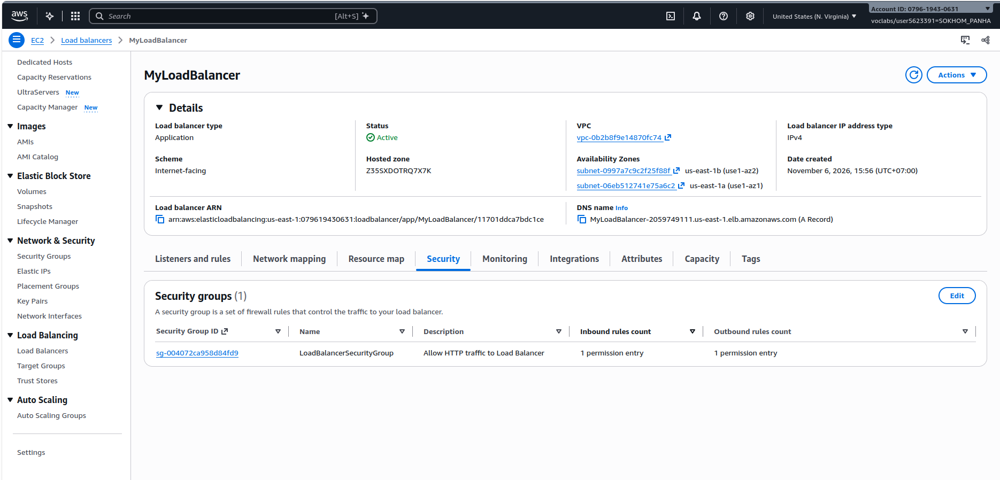

## Launch template

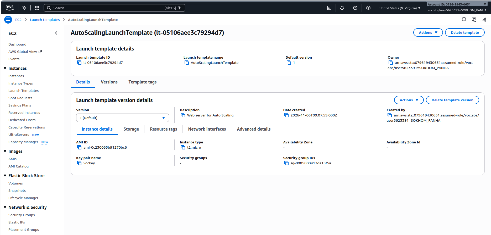

## Auto Scaling group

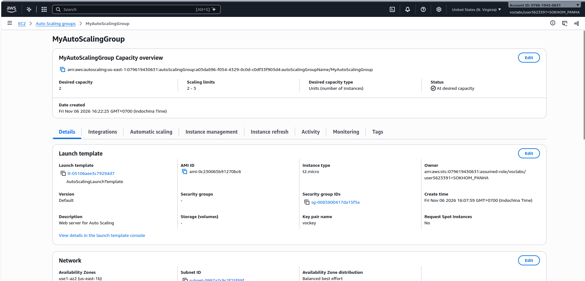

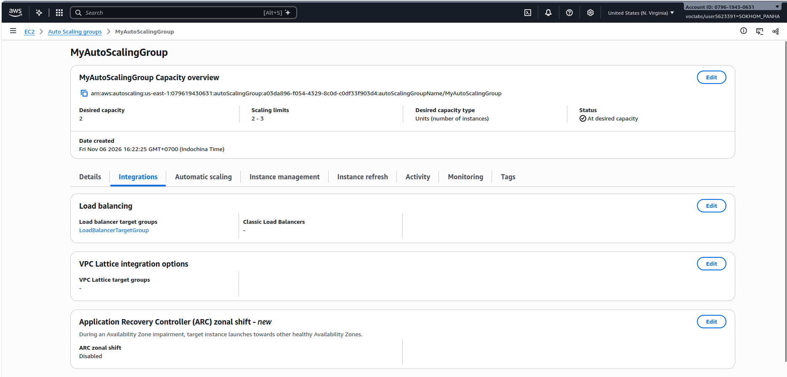

## Load balancing test

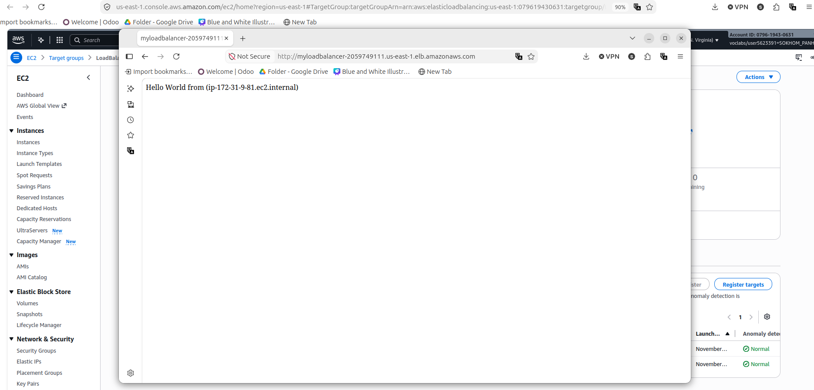

## Simulated application failure

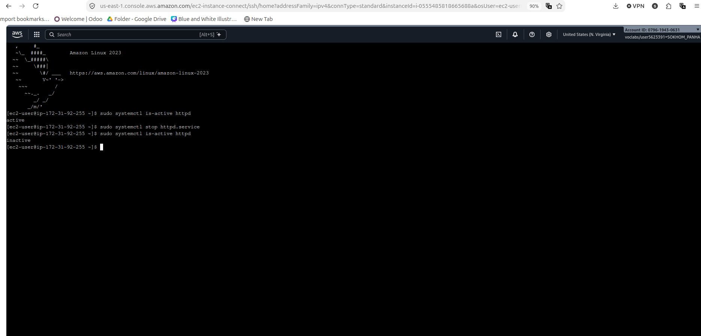

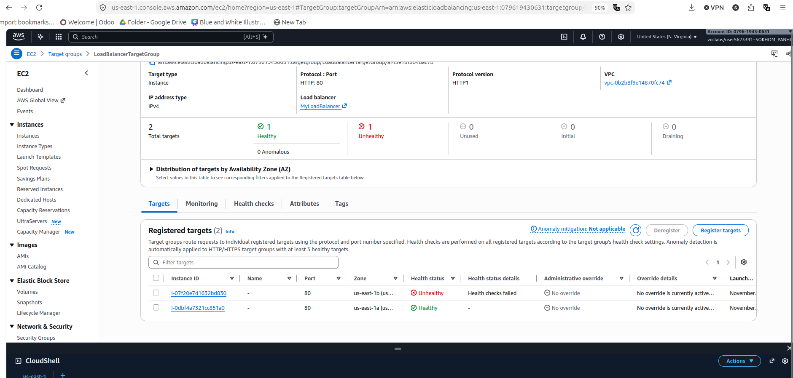

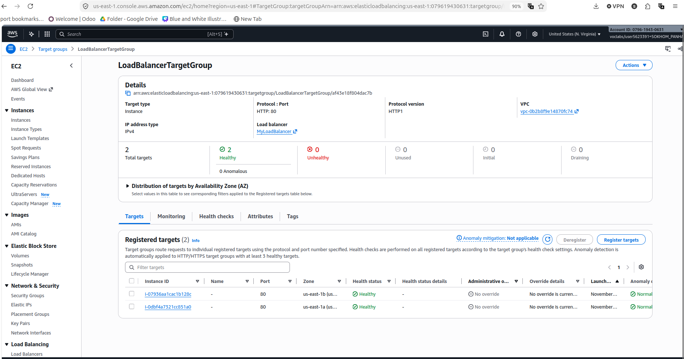

About how many minutes passed between stopping `httpd` and the new instance becoming healthy?

---

## Questions

### 1. Why does the page show a different host name when you refresh it?

The Application Load Balancer routes HTTP requests among healthy registered EC2 instances. Because each instance has its own hostname, a new request may return a different name when it is handled by another instance.

### 2. After you stopped `httpd`, the instance was still *running* in EC2, but the target group marked it *unhealthy*. What did the health check test, and why did the instance fail it?

The EC2 virtual machine and operating system were still running, but Apache was stopped. The target group's health check requested `/` over HTTP on port 80 and expected a successful HTTP `200` response. With Apache stopped, the service could not respond successfully, so the target was marked unhealthy.

### 3. Who replaced the failed instance: the load balancer, the target group, or the Auto Scaling group? Explain the role of each one.

The **Auto Scaling group** replaced it. The **load balancer** routes incoming requests to healthy targets. The **target group** registers instances and checks their application health. With ELB health checks enabled, the **Auto Scaling group** can act on that unhealthy status, terminate the failed instance, and launch a replacement to maintain desired capacity.

### 4. With desired 2, minimum 2 and maximum 3, how many instances run normally? In what situation could there be 3?

Normally **2 instances** run. The group's desired capacity can increase to **3**, for example after a manual capacity change or if a scaling policy is added. A third instance may also temporarily appear during certain replacement or maintenance operations, depending on the maintenance settings. This lab did not configure a metric-based scaling policy.

### 5. The instances' security group allows HTTP from anywhere. How could you change it so that the instances accept HTTP **only** from the load balancer?

In `LaunchTemplateSecurityGroup`, remove the inbound HTTP rule sourced from `0.0.0.0/0` and add an inbound HTTP rule on TCP port 80 whose **source is the security group ID of `LoadBalancerSecurityGroup`**. This restricts backend HTTP access to traffic originating from network interfaces associated with that security group. For production, SSH access should also be restricted.

## Problems and how I solved them (optional)

- **Instance connection:** I selected the public-subnet EC2 Instance Connect option instead of EC2 Instance Connect Endpoint, then connected as `ec2-user`.
- **Unhealthy evidence:** During the first failure test, Auto Scaling replaced the failed instance before I took the unhealthy screenshot. I repeated the test on a healthy instance and captured **1 Healthy / 1 Unhealthy**.
- **Replacement verification:** I compared EC2 instance IDs before and after recovery and confirmed that a new target became healthy.

## AI note (optional)

I used ChatGPT for guidance during the AWS configuration. One suggestion was to enable **Elastic Load Balancing health checks** in the Auto Scaling group. I checked the result by stopping Apache, observing the target become unhealthy, and confirming that Auto Scaling launched a healthy replacement.

## Clean up

Complete these steps **after** saving your report evidence to avoid further Learner Lab charges. Do not tick them until they are actually done.

- [ ] `MyAutoScalingGroup` deleted and its instances terminated.
- [ ] `AutoScalingLaunchTemplate` deleted.
- [ ] `MyLoadBalancer` and `LoadBalancerTargetGroup` deleted.
- [ ] Both security groups deleted.

## Conclusion

I configured an Application Load Balancer with an Auto Scaling group running two Apache web servers. Browser responses showed different instance hostnames, demonstrating request distribution. After Apache was stopped on one instance, the target group reported it unhealthy, and Auto Scaling replaced it. The final target group showed two healthy instances again.